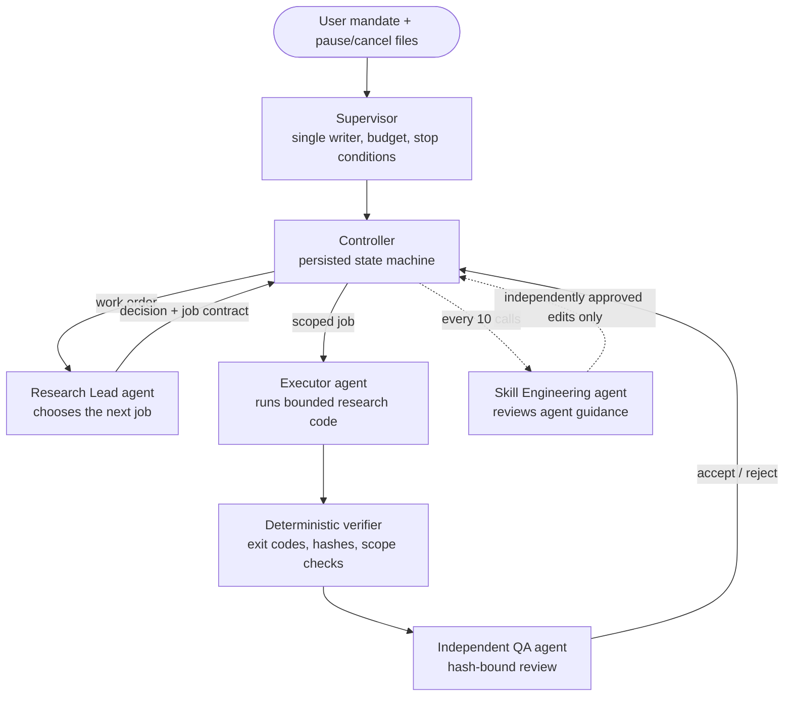

<div align="center">

# Autonomous AI Research Agent Loop

**A supervised multi-agent system in which LLM agents plan, run, review and audit offline trading-strategy research, with hard budgets, independent QA and no live trading.**


[Overview](#what-it-is) · [Architecture](#architecture) · [Safety](#safety-and-control) · [Results](#results-from-the-real-campaign-payout_v1-sepoct-2026)

</div>

---

## What it is

A Python controller that lets LLM agents run a long research campaign on their own: searching for
intraday futures strategies on historical data. Each agent has a narrow role, every result is
checked independently before it counts, and a single-writer supervisor enforces budgets and stop
conditions. Humans set the research mandate and can pause or cancel at any time, but do not relay
messages between agents.

## Results from the real campaign (PAYOUT_V1, Sep–Oct 2026)

| Metric | Value |
| --- | ---: |
| Model calls | **855** |
| Research Lead decisions | **329** |
| Messages relayed between agents by a human | **0** |
| Call budget used | 905 / 1,000 units |
| Job contracts created | 161 |
| …of which experiments | 37 (17 candidate strategies) |
| …of which diagnostics | 89 |
| Strategies that qualified | **0** |

The most useful finding was about the loop itself. A self-audit showed that **most calls went to
diagnostics, QA and evidence transport rather than to new market experiments**: 161 contracts
covered only 17 candidate strategies, and no strategy passed. The campaign was paused by its own
Research Lead. These numbers come from the campaign's runtime state and its final audit report,
which are not included in this repository (see [What is not included](#what-is-not-included)).

## Architecture



| Role | Job | Can it act alone? |
| --- | --- | --- |
| **Research Lead** | Picks the next experiment or diagnostic and writes a job contract | No: its decisions are schema- and permission-validated |
| **Executor** | Implements and runs the bounded job | No: runs only allow-listed commands inside its scope |
| **Verifier** | Deterministic checks of exit codes, file scope and hashes | No LLM involved |
| **Independent QA** | Reviews the evidence before the Lead can rely on it | Read-only; a missing or malformed verdict blocks the job |
| **Skill Engineering** | Every 10 calls, reviews whether the agents' guidance files still fit | Edits need a second independent review; it cannot grant permissions |

## Safety and control

- **Budget:** a hard cap of 1,000 call units. Reaching it stops the campaign (`RESOURCE_LIMIT`);
  there are no silent retries or refunds.
- **Stop conditions:** `pause.request` / `cancel.request` files, safety holds, terminal statuses and
  uncertain in-flight calls all stop the supervisor.
- **Scope:** workers run fixed entry points rather than arbitrary shell commands; file edits outside
  the job's scope are rejected.
- **Secrets:** API-key and token variables are stripped from the environment passed to agent CLIs,
  and credential folders are on the protected-path list.
- **Data:** jobs may read only the train, validation and synthetic partitions; the reserved test set
  and other protected paths are refused (`tools/quant_research_loop/__init__.py`).
- **No trading:** there is no broker integration. Live trading is disabled by design.
- **Evidence:** every model call leaves a receipt with timing; failed and superseded versions are
  kept, not overwritten.

## Repository layout

```text
tools/
├── agent_loop/            V1: single-task loop (plan → implement → verify → review → repair ≤ 2)
│   ├── controller.py      10-state machine and guardrails
│   ├── verifier.py        deterministic verifier
│   ├── opencode_runner.py fresh-session OpenCode CLI wrapper
│   └── cli.py
├── quant_research_loop/   V2: multi-agent research campaign
│   ├── supervisor.py      single-writer supervision, budget and stop conditions
│   ├── controller.py      persisted campaign controller
│   ├── schemas.py         validation of Lead decisions and job contracts
│   ├── qa_review.py       independent QA between executor/verifier and Lead
│   ├── worker_scope.py    scoped worker commands and receipts
│   ├── safety_hold.py     incident holds and bounded release
│   ├── skill_engineering.py
│   └── …                  recovery, routing, transport and lifecycle modules
└── test_*.py              35 test modules (437 tests)
```

## Run the tests

Python 3.12, standard library only for the test suite:

```powershell
py -3.12 -m unittest discover -s tools -p "test_*.py"
```

Expected: `Ran 437 tests … OK (skipped=1)`.

## What is not included

This repository is the orchestration code extracted from a larger private research workspace.

- **Not included:** market data, the campaign's runtime state, agent transcripts, research reports
  and the strategy simulators. Running a real campaign therefore needs that workspace and access to
  the model CLIs (Codex CLI with OpenAI models, OpenCode).
- **Five test modules were left out** because they read campaign evidence files that are not
  published.
- Some module and constant names (`PAYOUT_V1`, `R03`…`R27`) refer to the original campaign and its
  numbered mandate revisions.

## Limitations

- No strategy qualified, so this project demonstrates agent orchestration and evaluation discipline,
  not a profitable trading system.
- Most of the budget went to process (QA, diagnostics, evidence transport) rather than research
  breadth; that trade-off is the main lesson.
- The code was built with AI coding agents under human direction and review.
- Independent portfolio project. Not financial advice.

## Author

**Purinat Sritrairat**, B.Sc. Artificial Intelligence, Khon Kaen University ·
[GitHub](https://github.com/Avocadough)
